# VH-Inventory — Product Manual

VH-Inventory is a home **inventory & grocery system** that runs inside Home Assistant. It
lets you track what you own, where it is stored, how much you have, and what you need to
buy — driven either by barcode scanning or manual entry. The interface is fully
multi-language (English / Nederlands out of the box).

> **Audience:** end users of the dashboard. For installation, see `INSTALLATION.md`.

**Optional ThinkSmart LED ring:** the Keuken TS ThinkSmart Hub 500 can expose its
physical ring as a Home Assistant MQTT select, with green, red, white and off
options. The separate Windows bridge and
[installation guide](../hardware/ThinkSmart-Hub-500-LED/README.md) live under
`hardware/ThinkSmart-Hub-500-LED`. It does not automatically tie ring colors to
scans or stock changes; any such automation must be configured separately.

---

## 1. Core concepts

| Concept | Meaning |
|---|---|
| **Product** | A catalogue item (name, barcode, manufacturer, unit, category, store, auto-add settings). Defined once, reused everywhere. |
| **Inventory (Stock)** | How many of a product you currently have, at a **location**. A product only appears here while it has stock — when its stock reaches **0** it drops off the inventory (the product itself and any shopping-list entry are kept). |
| **Location** | Where stock is stored (e.g. *Pantry*, *Garage freezer*). |
| **Category** | A grouping for products (e.g. *Coffee*, *Cleaning*). |
| **Store** | Where you usually buy a product (e.g. *Jumbo*, *Kruidvat*). |
| **Shopping list** | Items you need to buy. Populated manually or automatically. |
| **Scan queue** | A staging area for scanned barcodes awaiting resolution into products. |
| **History** | An audit log of every add/edit/delete action. |

**Auto-Add** is the link between stock and the shopping list: when a product is enabled
for auto-add and its stock drops to/under its **threshold**, the product can be placed on
the shopping list at its configured **quantity**.

**Zero stock is never kept in the inventory.** As soon as a product's total stock reaches
0 it is removed from the Inventory tab, so the list only ever shows what you actually have.
The product definition and its shopping-list entry are untouched, and the product
reappears in the inventory automatically the moment you restock it.

---

## 2. The dashboard at a glance

The dashboard lives at `/vh-inventory/main` and is organised as a row of tabs. Most tabs have
an **Add** button (opens a pop-up), a data table, and per-row **Edit** / **Delete** controls.
**Woonkamer** and **Kantoor** buttons in the footer (right-aligned) jump to those touchscreen
dashboards.

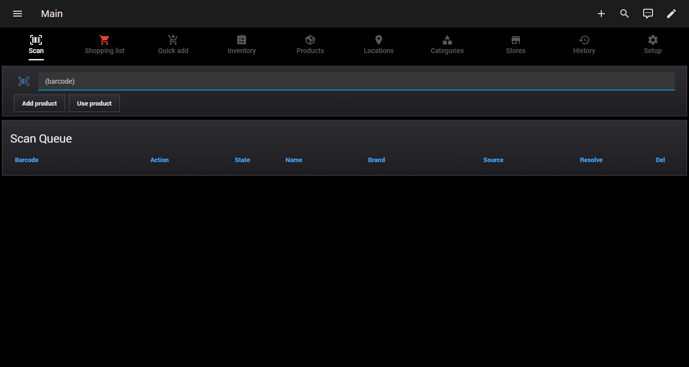

The tabs, left to right:

| Tab | Purpose |
|---|---|
| **Shopping list** | Items to buy; print to a thermal receipt printer (grouped per store). |
| **Quick Shopping** | One-tap add/remove of products on the shopping list, split into two sections. |
| **Quick Inventory** | One-tap remove-from-stock or add-to-stock of products. |
| **Inventory** | Current stock per product, category and location; filter and print by category. |
| **Products** | The product catalogue. |
| **Locations** | Storage locations. |
| **Categories** | Product categories. |
| **Stores** | Shops. |
| **Scan** | Scan or type barcodes; Add/Use flow; resolve unknown items. |
| **History** | Audit log of all changes (latest 50 shown). |
| **Setup** | App settings: language selector, *Show ID columns* / *Hide header (kiosk)* toggles, and the *Handheld scanner*, *Similarity checking*, *Alternative in stock*, *Spoken announcements (TTS)* and *Mobile notifications* sections. |

### Keuken Touchscreen

The optional **Keuken Touchscreen** dashboard is separate from the tabbed dashboard.
Open `/keuken-touchscreen/scan` on a 1920 x 1080 landscape screen. The pink
**mdi:menu** hamburger at the top right opens **Boodschappenlijst en voorraad**,
**Recepten**, **Keuken**, **Boodschappenlijst**, **Snelle Boodschappen**, **Snelle Voorraad**,
**Configuratie**, and **Onderhoud**. The bottom bar is removed so page content
uses the recovered height.
Vertical scrollbar indicators are hidden while page and popup scrolling remain
available. Wide tables still scroll horizontally.
Expand **Onderhoud** for **Voorraad**, **Producten**, **Locaties**, **Categorieën**
and **Winkels**. The menu closes after selecting a page, using its close button,
tapping outside or pressing Escape. The active page is highlighted; the menu
scrolls on short screens and leaves filters and drafts intact. Save or discard
unsaved edits before switching pages. Barcode and Product have no adjacent action
buttons. Submit a barcode with the scanner's Enter suffix or keyboard Enter.
The mode buttons appear in that order, with Opzoeken selected initially.
The scan-page title is **Boodschappenlijst en voorraad** in Dutch and
**Shopping list and stock** in English. Scanmodus, Scan je product and Zoek je
product are three separate cards with matching backgrounds and aligned left
edges beside the logo. Scanmodus includes the pink tune icon, explanation and
four mode buttons. Product details stay on the right at desktop widths.
The hamburger glyph is 74.8px, 70% larger than before, with a 104px touch button.
Equally sized **Home**, **Recepten**, **Verlichting** and **Boodschappenlijst**
shortcuts sit immediately to its left. Home returns to **Boodschappenlijst en voorraad**.
Selected shortcut icons are black on solid pink, including hover in both themes.
The recipe icon is an outlined open book with visible page lines.
Verlichting opens the kitchen controls without
toggling a device; Boodschappenlijst opens the shopping list. Pending scans,
shopping choices and unsaved edits still prevent navigation. On small screens
the five buttons wrap into three rows at widths up to 600px, with heading space reserved below them.
Narrow screens stack the columns and allow scrolling.
All twelve views and recipe cook mode use the same responsive horizontal margins.
The scan-page logo and cards share that left edge without an extra menu gutter.
The idle product-details area shows six Dutch headlines, two each from NOS,
NU.nl and Omroep Brabant. An independent worker refreshes them every 15 minutes.
Source/time labels and an updated timestamp remain visible. Cached or failed
sources are explicitly labelled; news problems never disable scanning.
Scanning or selecting a product replaces news with its details; Cancel or normal
result dismissal restores it. Processing, unsaved drafts and uncertain actions
keep priority. News and every product-details/registration card align with the
bottom of the visible left-hand cards on desktop, including when Zoek je product
is hidden in Toevoegen. Long right-hand content scrolls internally, keeping the
action buttons accessible. Narrow screens stack naturally.
The offline preview still uses clearly labelled fictitious headlines and no feeds.
Tap a headline to read its short RSS preview inside
the same card. **Terug naar de koppen** returns to the current list.
The full-story button was removed in `20261023-news-kiosk1`: HA-WinKiosk handed
those links to external Edge windows, while publishers block their original pages
from being embedded in the card. News now stays inside the dashboard.
The preview does not load publisher scripts, ads or images.

**Current backend `20261023-alt-stock-batch1`: similar stock after Verbruikt.**
The current frontend is home-shortcut1. The backend fixes an error in alternative-stock
history logging that could show an uncertain scan after stock was deducted.
Never repeat an uncertain scan without first checking stock and shopping.
When the scanned product would go on the shopping list but an equivalent product
is still on the shelf, the details card lists those equivalents and quantities.
**Zet op de boodschappen lijst** adds the scanned product, not its substitute.
**Niet op de boodschappen lijst zetten** leaves the shopping list unchanged.
Stock has already been processed once; neither button decreases it again.
Choose before scanning another product or leaving the page. The choice stays open
instead of disappearing after ten seconds. Reloading never implicitly adds shopping.
The same flow follows an explicitly confirmed name-search Verbruikt action.
After choosing, the card shows **Product aan de boodschappenlijst toegevoegd**
or **Product niet aan de boodschappenlijst toegevoegd**, together with the updated
stock. Ten seconds later, it returns to the news card.
The configured auto-add threshold still applies. With threshold 2, consuming
2 to 1 can already show the choice. If you choose No, consuming 1 to 0 can show
it again. If you choose Yes, the product is already listed and will not be added
or offered again. Existing shopping entries are never removed by No.
The two Houdbare Magere Melk products from PLUS and JUMBO can match because only
their brands differ. All equivalents are checked in one AI request, rather than
successive requests for additional matches. The AI can still take several seconds.

Matching follows the ESPHome settings, not a new name-only comparison. The selected
AI policy permits different brands/shelf life, but not different product types:
halfvolle houdbaar can match halfvolle; magere does not. AI must be enabled and
healthy for semantic decisions; its existing configured offline/error fallback
still applies. The touchscreen excludes explicit magere/halfvolle/volle conflicts
before either matching route, even if the AI would accept them. Houdbare Magere
Melk (JUMBO) can be offered for Houdbare Magere Melk (PLUS); Halfvolle melk cannot.
If no equivalent is found, normal shopping rules remain in force.
Touchscreen actions never open questions on ESPHome scanners. Add skips the
physical similarity popup. Bijna op, Snelle Voorraad and inventory quantity
edits/deletions follow normal auto-add rules without a physical-scanner choice.
The ESPHome scanners keep their own existing behavior for scans made on them.
Feed refreshes do not replace a story being read. Scanning temporarily replaces
the reader with product details; closing those details restores the selected preview.
Missing previews/links are clearly labelled. The fictitious offline examples do
not link to fabricated full stories.
Scanning in Opzoeken does not write automatically; saving edited details is explicit.
Verbruikt is a scan-page display label only; the internal action remains `Use`.
The main dashboard and Snelle Voorraad keep their existing labels.
Undefined category/store/location fields and empty reference choices are blank
on Keuken TS. The explicit Niet toegewezen category filter, ad-hoc item labels
and broken-reference warnings remain labelled. Stored values and the original
dashboard are unchanged.
Before the first scan, the last-scanned-product panel is hidden. Successful saves
and stock actions show their result for 10 seconds or until the next scan.
**Afbreken** discards changes and hides the panel immediately. Unsaved drafts and
save errors remain visible until addressed.
Online matches in Toevoegen say **Nieuw product gevonden online**. Unknown
Bijna op/Verbruikt barcodes say **Product niet gevonden in de voorraad** and
hide after 10 seconds without changing data.
The scan icon and instructions share a vertically centered row. Below the barcode
hint, a pink **mdi:keyboard-outline** icon and **Zoek je product** introduce a second **Product** field with
**Type minimaal 4 letters** underneath and the current mode beside it.
In **Opzoeken**, **Bijna op** or **Verbruikt**, tap the Product field or focus it
and press Enter to open the search popup.
Type at least four characters of a product name. Matches update in a scrollable
list below the input. Select one, or submit a unique match, to close search and
open details. **Opzoeken** shows editable fields with **Opslaan** and **Afbreken**.
**Bijna op** and **Verbruikt** show read-only fields with **Afbreken** and the
selected action. Selecting a product changes nothing. **Afbreken** closes without
changes; confirming the mode action uses the existing scanner behavior, including
counted-once Bijna op stock. Pending actions stay open; successful actions close
after 10 seconds. If stock changed since selection, search again before confirming.
Do not retry uncertain writes without checking inventory. The popup adapts to the
visible viewport when the keyboard opens; its close button or Escape cancels
without saving. Name search ignores case/accents and includes products without
barcodes. The whole search section is hidden only in **Toevoegen**.
Search never looks online or changes stock while typing or selecting.
The large colored feedback box is removed; errors remain visible as compact messages.
The scan-page Barcode field requests no onscreen keyboard on focus. A physical
keyboard or keyboard-mode scanner still works, including Enter submission.
Product-editor barcode inputs keep their numeric keyboard hints. Native keyboard
suppression depends on the browser/device and should be checked on the touchscreen.

| Page | What you can do |
|---|---|
| **Keuken** | Third hamburger-menu entry or `#kitchen`; page heading **Keuken - Verlichting en muziek**. Control Werkblad/Plafond power, brightness and warm/cool white, plus native Sonos kitchen playback, volume, mute, now-playing and radio/source selection. |
| **Boodschappenlijst en voorraad** | First menu entry; the existing scan page. Scan with a USB/Bluetooth keyboard scanner. **Opzoeken** shows editable product details with **Opslaan** and **Afbreken**; barcode stays fixed. Saving updates an existing product without changing total stock or shopping quantities. Known Toevoegen/Verbruikt/Bijna op results are read-only and show the stock or marker outcome. Unknown barcodes in Opzoeken and Toevoegen fetch online details as an editable **Nog niet opgeslagen** draft; misses or failures allow manual entry. The badge shows **Online** for an online draft or **Uit database** for saved data. Only **Opslaan** creates a product: Opzoeken saves metadata only; Toevoegen also adds one stock item at the chosen location. No new scan-queue row is created. Unknown Bijna op/Verbruikt products cannot be registered here. |
| **Boodschappenlijst** | View catalogue and ad-hoc items, adjust quantities and confirm removal. **Boodschappenlijst afdrukken** prints the full list using the same server script and per-store receipt layout as the main dashboard. Opens directly at `/keuken-touchscreen/scan#shopping`. |
| **Snelle Boodschappen** | Search catalogue-product buttons and tap to add quantity 1 or remove the entire shopping entry. Opens directly at `/keuken-touchscreen/scan#quick-shopping`. |
| **Snelle Voorraad** | Search product buttons; tap an in-stock item to use 1, or an out-of-stock product to add 1. Stock buttons show a small number-only quantity block at the bottom-left, without a location field. Opens directly at `/keuken-touchscreen/scan#quick-stock`. |
| **Voorraad** | Open from Onderhoud in the hamburger menu. By default shows positive stock per location without Bijna op products. Two initially-off switches include Bijna op and zero-stock products; either reveals a product in both groups. At zero stock, bordered category/store/location fields match stocked rows; **+** adds one unassigned unit and the pencil opens the Producten editor. No per-row Toevoegen button; Actie keeps the pencil. The page-level Add form still accepts location and quantity. Stocked rows show minus, plus and a pencil, with no separate Verwijderen button. Minus confirms removal of the last unit. Search, category filtering, full stock editing and printing remain available; Bijna op flags are preserved. Opens directly at `/keuken-touchscreen/scan#inventory`. |
| **Producten** | Open from Onderhoud in the hamburger menu or `#products`. Search the full catalogue, add/edit all product fields and Auto-Add settings, change category/store/threshold/quantity inline, or confirm product deletion including linked stock/shopping entries. |
| **Locaties** | Open from Onderhoud in the hamburger menu or `#locations`. Search, add, rename and delete unused locations. Existing stock links retain their IDs when renamed. |
| **Categorieën** | Open from Onderhoud in the hamburger menu or `#categories`. Search, add, rename and delete unused categories. Product links are preserved. |
| **Winkels** | Open from Onderhoud in the hamburger menu or `#stores`. Search, add, rename and delete unused stores. Product links are preserved. |
| **Configuratie** | Open Configuratie in the hamburger menu, above Onderhoud, or `#configuration`. Access the same shared application, TTS/Sonos, notification, handheld, AI, similarity, alternative-stock and three-scanner settings as the main Setup tab. |

Shopping printing reports a request sent, not physical completion. Repeated taps
are disabled while pending. If the result is uncertain, check the printer and use
**Boodschappenlijst vernieuwen** before trying again; refresh does not print.

Werkblad and Plafond show bulb badges: warm/cool color follows Kelvin and icon
intensity follows brightness. Known numeric values remain available through
the tooltip and accessible name. Off uses an outlined bulb-off
icon, while unavailable has a neutral question icon. The existing power buttons
and sliders still perform the actions.

Sonos uses one row of bordered Play/Pause, Mute/Unmute, Previous track and Next
track icon buttons. Play/Pause turns pink while playing; Mute turns pink while
muted. They follow the reported player state independently.
Their tooltips and accessible names describe the action in the selected language.

Keuken uses `light.z_keuken_werkblad`, `light.z_keuken_plafond` and
`media_player.keuken`, not the Music Assistant duplicate. Turn a light on before
adjusting its sliders. Unsupported/offline controls are disabled. **Radio / Bron**
shows Sonos favorites as logo tiles, with an accent border for the current source.
Tap a tile to choose that station using the same source-selection action as before.
The five existing station logos are stored locally; a favorite without artwork
shows its name. Slider release sends one command. Group playback can affect other
speakers. If a response is uncertain, do not repeat it: use **Bediening vernieuwen**
and check the device first. Opening or navigating the page sends no device commands.
Kitchen controls do not change inventory or TTS settings.
Otherwise available controls keep their normal appearance while a command is
pending, but remain locked against extra taps. The status message reports
progress; unavailable controls still look disabled.
Feedback, slider values and player details have reserved space even while empty.
Appearing values, status, title/artist and group warnings do not move the other
controls. Long text scrolls inside its own focusable area instead of expanding
the card; its full text is also available in the tooltip.
Sonos status stays on one line in a wider slot. Longer statuses scroll
horizontally within that slot instead of wrapping.
The Barcode and Product fields use the full available row width, with no adjacent
buttons. Changing the mode does not resize either field.
Across all twelve views, feedback, recovery controls and changing text have
reserved space. Scan product titles, descriptions and editing feedback do not
move other fields when text wraps. Table metadata and quick-action tiles keep
consistent dimensions; configuration values and speaker-choice lists scroll
within their own areas. Long text remains readable by scrolling, with full-text
tooltips where applicable. When scan recovery is needed, **Stock checked,
continue** replaces the keyboard helper below Barcode.
Opening an editor, changing filters or adding/removing records still changes
the displayed content intentionally.
**Recepten**, the second hamburger-menu entry, opens a simple read-only Mealie browser.
Search the recipes accessible to the kitchen account, tap a recipe for its
ingredients, preparation and notes. Search is hidden while reading a recipe.
Recipe tiles include a thumbnail when available. A compact photo appears beside
the recipe details; the full picture fits within its frame. Missing or failed
photos show a pink cookbook icon in the same fixed space without shifting
the page. **Foto niet beschikbaar** remains available to screen readers but
is no longer displayed. Photographs require a configured Mealie image origin reachable from
the browser; no Mealie login is requested on the dashboard.
The gap below search is smaller: recipe count and feedback share one compact,
fixed-height row. Long feedback scrolls within that row instead of moving recipes.
Tap the expand icon beside **Bereiding** for cook mode: preparation fills the
available content area in a larger font. The collapse icon returns to
the full recipe at your previous scroll position. The icons have large touch
targets even though the symbols are compact. The **Recepten** shortcut and the
hamburger-menu entry both return to the overview with your search preserved.
Cook mode does not change or reload the recipe.
The overview fetches the current recipes when opened and checks every 30 seconds
while visible. New recipes appear automatically without clearing search or scroll
position. These background reads do not interrupt an open recipe. Updates pause
while the browser tab is hidden or another page is open.
There is no separate back button. **Vernieuwen** appears only after an error and
retries the failed recipe or list read. Loading and error feedback retain their
own space; long recipe content scrolls within the available page height.
No recipes, meal plans, shopping lists or inventory data are changed.
The official Home Assistant Mealie integration must be configured first.
After HA confirms the requested state, feedback changes to **Succesvol uitgevoerd.**
or **Successfully executed.** This is HA state confirmation, not independent
physical verification. LED presets and previous/next retain request-sent feedback.
Sliders use explicit track/thumb styling so the browser does not grey them during
that temporary lock. On narrow screens, the player-button row scrolls horizontally
without shrinking its touch targets or wrapping.
Below Werkblad, the separate **Ledstrip** panel provides **Warm**, **Koud** and **Uit**,
using the same preset automations as the woonkamer-TS kitchen popup.
Uit dims the strip to zero; it does not switch its power relay. Presets confirm only
that the request was sent, without claiming an observed color or physical result.
**Automatisch uit (Werkblad)** and **Voeding** are no longer displayed. The existing
Werkblad-light automatic-off automation and LED relay are unchanged.
Other controls update in real time. **Bediening vernieuwen** is shown only after a failed or
uncertain action/refresh and disappears after successful recovery, not during normal use.

Snelle Voorraad taps save immediately without confirmation. A product moves to the
add grid only when all its locations are depleted. Adding creates quantity 1 at an
unassigned location unless an existing row is available. Existing automatic
shopping-list rules still apply when stock changes.

In **Voorraad bewerken**, Product is free text for renaming the same catalogue
record, not a selector for another product. The field rows are Barcode/Product,
Fabrikant/Winkel, Categorie/Eenheid, and Locatie/Aantal. **Opslaan** saves the draft;
**Afbreken** discards it. Product fields apply everywhere that product appears;
location and quantity apply only to the selected stock row. IDs and existing
database links remain unchanged.

Management forms use local drafts, not the main dashboard's shared inputs.
Product names are free text. Product deletion removes all its stock and
shopping-list rows after explicit confirmation. Locations, categories and stores
cannot be deleted while referenced; the backend checks this atomically along
with the expected name and history write. Renaming preserves IDs and links.

Configuration offers **Volledig scherm (Keuken Touchscreen)** under Application settings. It
hides both Home Assistant bars when enabled and restores them when disabled.
It applies to all browsers using Keuken Touchscreen and remembers your choice
across restarts, independently of the main dashboard's **Kop verbergen (kiosk)**.
The hamburger menu and Configuratie remain available in fullscreen.
Browser tabs/address bars are separate; use the browser's fullscreen mode for those.

Configuration text, numeric and dropdown edits require **Opslaan**; **Afbreken**
discards them. On/off and target-selection buttons apply immediately, but scanner
print switches require confirmation. Limits/options come from HA; offline entities
cannot be edited and counters/scans are read-only. Language is shared by both
dashboards; ID columns and kiosk/header settings still apply only to main.
Configuration always offers
**Instellingen vernieuwen**, including speaker discovery and uncertain-write recovery.
Changes affect the existing application and devices, not independent copies.

Inline management dropdowns, product threshold/quantity fields and quantity buttons save immediately. The full editor saves
only when you press Opslaan. Management refresh buttons appear only for errors/recovery.
An uncertain write is never retried automatically; refresh and check the real
stock/shopping list before trying again.

For setup, scanner behavior, editing safeguards and known limitations, see
the [Keuken Touchscreen guide](TOUCHSCREEN.md). The main dashboard and scanner
modes are not replaced or changed by opening this dashboard.

The **Snelle Boodschappen** page mirrors
the main dashboard's Quick Shopping grid. Search by name/barcode, tap to add a
catalogue product at quantity 1, or tap an existing product to remove its entire
shopping-list entry without confirmation. Stock and ad-hoc items are unchanged.
It is available from the shared top-right hamburger menu.
See the [behavior and recovery rules](TOUCHSCREEN.md#snelle-boodschappen-page).

---

## 3. Setting up your reference data

Before scanning or tracking stock, create the building blocks. Order doesn't strictly
matter, but **Locations**, **Categories** and **Stores** are useful first because products
reference them.

### Locations

Open the **Locations** tab, press **Add**, type the location name, and save.

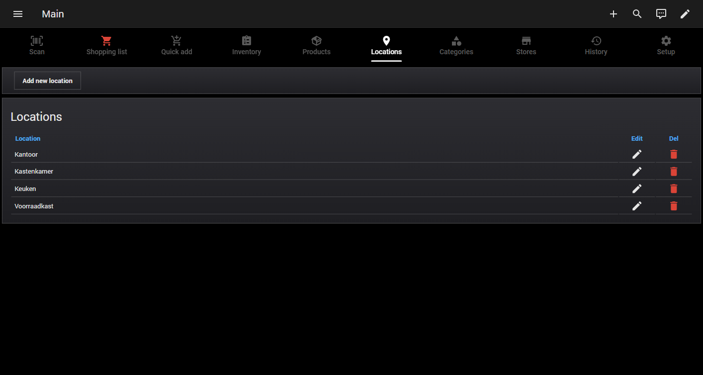

### Categories

Open the **Categories** tab, press **Add**, type the category name, and save.

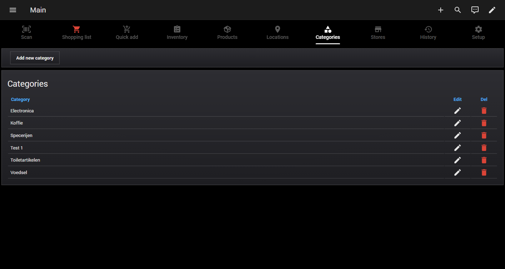

### Stores

Open the **Stores** tab, press **Add**, type the store name, and save.

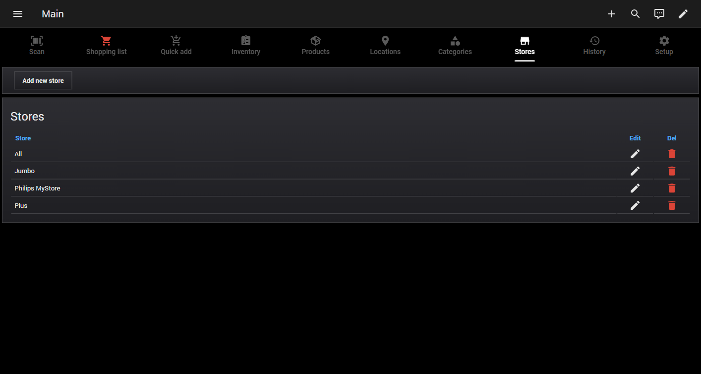

> Newly added locations, categories and stores become immediately available in the
> dropdowns used by products and inventory (the inline pickers refresh on open).

---

## 4. Products

The **Products** tab is your catalogue. Each product carries a name, barcode,
manufacturer, unit, category, store, and its auto-add settings.

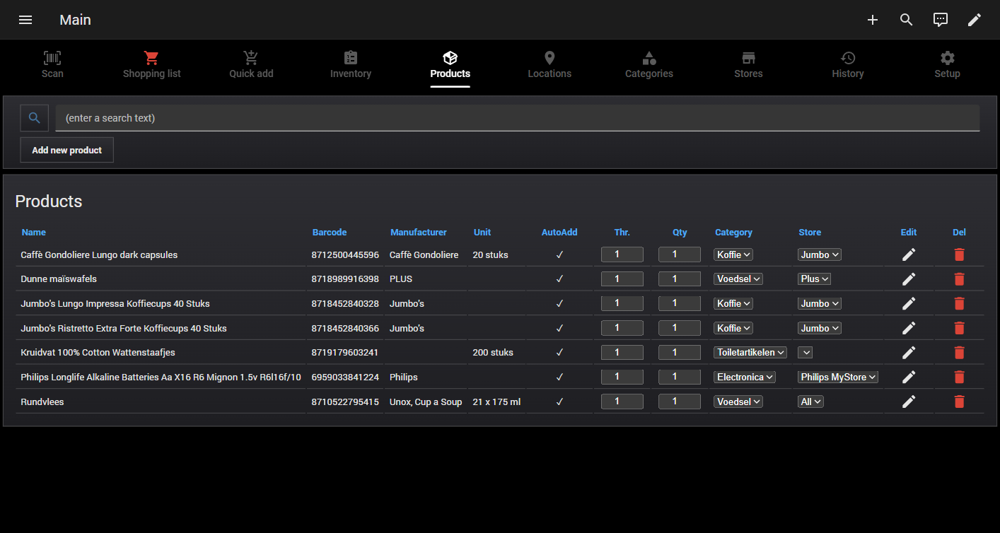

### Adding a product manually

Press **Add** to open the **Add Product** pop-up and fill in the fields:

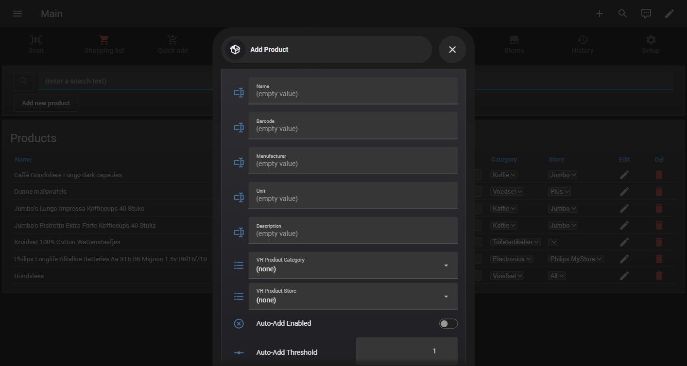

| Field | Notes |
|---|---|
| **Name** | Required. |
| **Barcode** | Optional; numeric. Used to match future scans. |
| **Manufacturer / Unit / Description** | Optional descriptive fields. |
| **Category / Store** | Pick from your reference lists (or `(none)`). |
| **Auto-Add Enabled** | Turn on automatic shopping-list top-up. |
| **Auto-Add Threshold** | Stock level at/under which the item is needed. |
| **Auto-Add Quantity** | How many to put on the shopping list. |

Press **Save** to store the product (the pop-up closes automatically). Use **Cancel** to
discard.

### Editing / deleting a product

Each row has an **Edit** (pencil) and **Delete** (trash) control. Editing opens a pre-filled
pop-up. Deleting a product also removes its related **inventory** and **shopping-list**
rows (cascade delete).

---

## 5. Tracking stock (Inventory)

The **Inventory** tab shows how much of each product you have, its category, and where it
is stored.

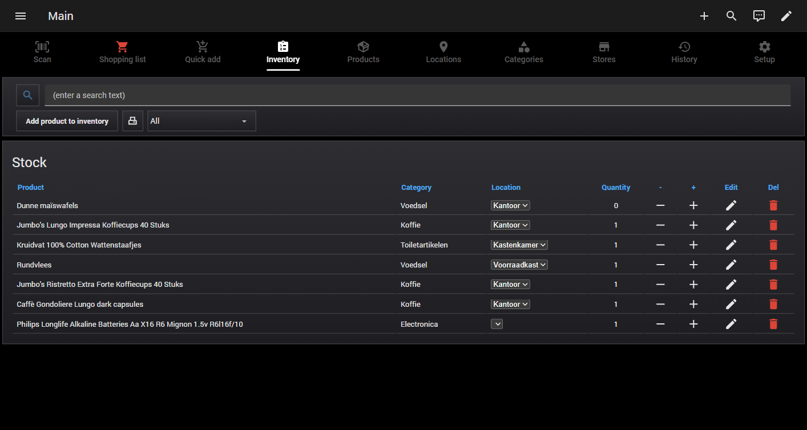

- Press **Add product to inventory** to record stock: pick a product, a location, and a
  quantity.
- Each row shows the product's **Category** and its **Location**, both of which you can
  change inline via a dropdown. (Category is a property of the product, so changing it here
  updates that product everywhere it appears.)
- Quick **+ / –** controls adjust quantity.
- Stock changes feed the auto-add logic and are written to **History**.
- When a product's quantity reaches **0** it disappears from this tab (kept on the shopping
  list if it was auto-added). Restocking it — by scanning **Add** or using *Add product to
  inventory* — brings it back.

### Filtering and printing by category

Next to the *Add product to inventory* button are a **printer** icon and a **category
dropdown**:

- Pick a category from the dropdown to **filter the table** to just that category's
  products. Leave it on **All** to show everything.
- Press the **printer icon** to print the inventory to the thermal printer. The printout is
  grouped by category; if a specific category is selected it prints only that one, otherwise
  it prints every category. The title remains centred and double-size, followed by the
  category sections and a timestamped footer before the final cut.

### Handheld scanner mode (Add / Use)

Between the *Add product to inventory* button and the printer icon is a **mode toggle**
button for the [handheld scanner](#7-scanning-workflow). It shows the scanner's current mode
and switches it on tap:

- **Scanner in ADD mode** (cyan by default) — scanned barcodes **increase** stock.
- **Scanner in USE mode** (red by default) — scanned barcodes **consume** stock (and fall
  back to the shopping list, resolving unknown barcodes online first).

The two colours are configurable on the Setup tab (*Handheld scanner → Color Add mode /
Color Use mode*). The mode is shared by every handheld scan until you toggle it again.

> **Tip:** the search box on the Inventory, Products and other tables matches on **product
> name *or* barcode** — type any part of either to filter.

---

## 5a. Quick Shopping

The **Quick Shopping** tab is the fastest way to build a shopping list. Every product is shown
as a button, split into two sections:

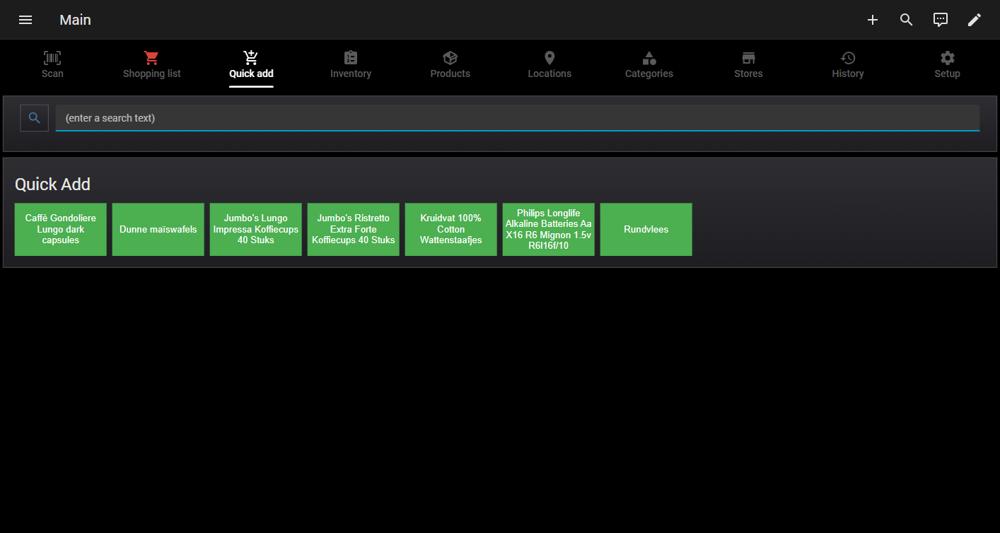

- **Add to Shopping List** — products that are *not* yet on the list. Tapping a product adds it.
- **Remove from shopping list** — products already on the list. Tapping a product removes it.

Products move between the two sections automatically as you tap. Use the search box to narrow
the buttons by name.

---

## 5b. Quick Inventory

The **Quick Inventory** tab lets you adjust stock with a single tap, split into two sections:

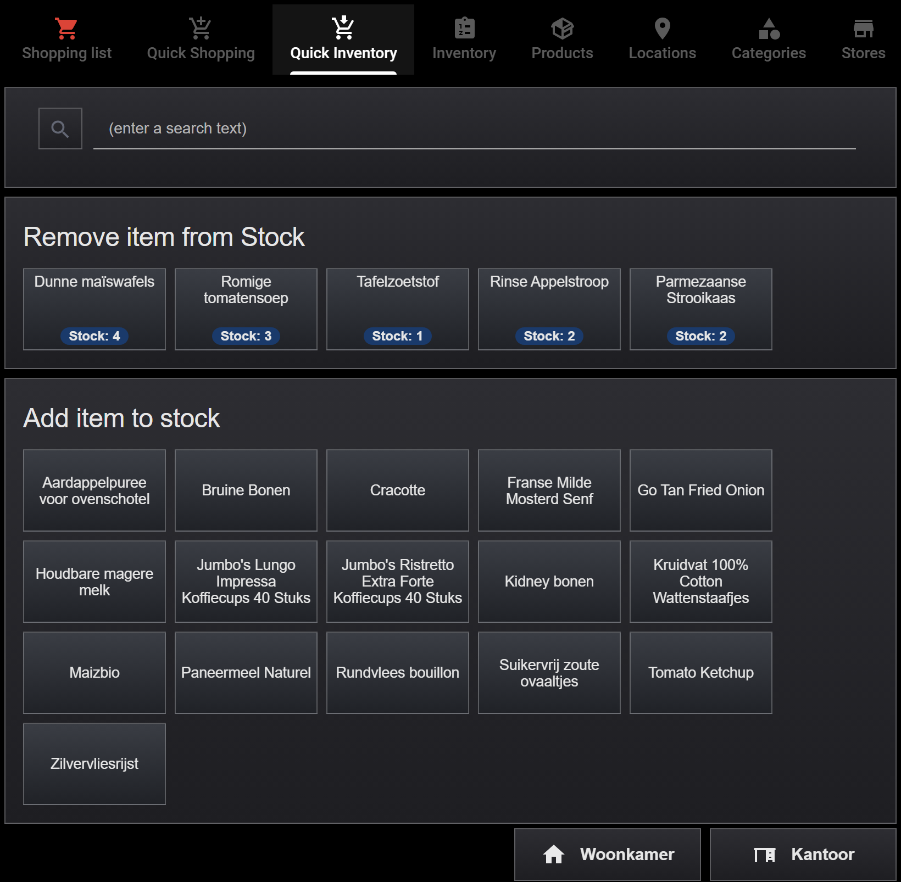

- **Remove item from Stock** — in-stock products (quantity > 0), each showing its current
  **Stock:** count on a blue badge. Tapping decrements the stock by 1; when a product hits 0 it
  drops off this section.
- **Add item to stock** — catalogue products that are *not* currently in stock. Tapping adds the
  product to inventory (quantity 1), after which it moves to the *Remove item from Stock* section.

Use the search box to narrow the buttons by name.

---

## 6. The shopping list

The **Shopping list** tab holds what you need to buy.

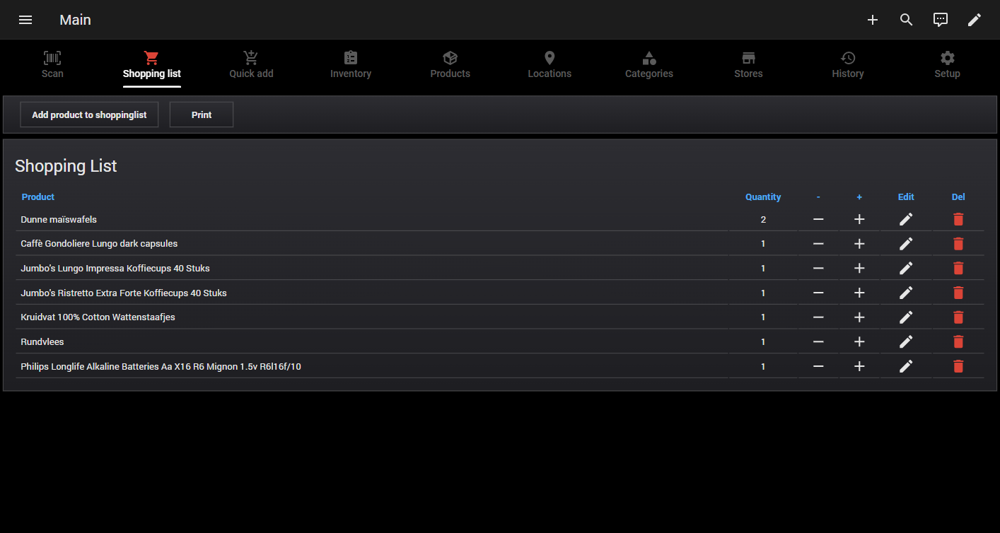

- Add items with the **Add item** button, which opens the **Quick Shopping** tab (tap products
  to add them to the list). **Auto-Add** can also populate the list automatically when stock
  runs low.
- Use **Add Ad-Hoc product** when you only know a general product name. Enter a name and
  quantity; the item is added directly to the shopping list and is deliberately **not**
  stored in the Products database. Ad-Hoc rows carry a compact **Ad-Hoc** badge.
- Adjust quantities with the **+ / –** buttons. Pressing **–** on an item at quantity 1
  removes it from the list (there are no separate edit/delete controls on this tab).
- When the shopping list contains items, the cart icon is highlighted (styling cue).

### Printing the shopping list

Press **Print** to send the list to the connected **Epson TM-T20II** (ESC/POS) thermal
printer. The receipt is organised **per store**: each store from the Stores tab prints as a
header followed by its items, and a final **Algemeen** section lists everything with no store
assigned (or set to *All*). Add or rename stores on the Stores tab and the next printout
reflects the change automatically. Ad-Hoc products have no store assignment and therefore
print under **Algemeen**. The receipt keeps its centred double-size **Boodschappenlijst**
title, item body, timestamped footer, and final partial cut together.

For a network printer, enable **Keep persistent connection** under **Settings → Devices &
services → ESC/POS Thermal Printer → Configure**. The receipt uses separately styled
header, body, and footer sections; Keep Alive sends them over one ordered TCP stream.
VH-Inventory queues repeated print requests, so pressing **Print** again while a receipt is
still printing adds the next receipt to the queue instead of interleaving both jobs.

If a receipt is split, reordered, misses its title/footer, or does not cut, first verify that
**Keep persistent connection** is still enabled. Integration upgrades or printer
reconfiguration can reset connection options.

---

## 7. Scanning workflow

The **Scan** tab is the fastest way to update inventory using a barcode scanner (or by
typing a barcode). When you open the Scan tab, the cursor automatically lands in the
**Barcode** field so you can scan straight away.

### Add vs. Use

After entering a barcode, choose an action:

- **Add** — you are *putting an item in* (bought/restocked). Increases stock.
- **Use** — you are *consuming an item*. Decreases stock; when the last one is used the
  product leaves the inventory. If the product is set to auto-add (or you *Use* something
  you no longer have in stock at all), it is placed on the shopping list.

Each scan creates a row in the **Scan Queue** with a **State**:

| State | Meaning |
|---|---|
| **Exist** | The barcode matches a product already in your catalogue. The action is applied directly. |
| **New / Lookup** | The barcode was resolved online (Open Food Facts / UPC Item DB) and pre-filled details are available to create the product. |
| **Unknown** | The barcode could not be resolved online. You resolve it manually (see below). |
| **Manual** | Reserved for manual handling. |

The **Source** column shows which provider resolved the item; the **Resolve** column offers
an action to (re)resolve a row.

### Resolving an Unknown barcode

When a scan can't be resolved automatically, its row shows the **Unknown** state with a
**Resolve** (wrench) action. Pressing it opens a product pop-up pre-filled with the
unresolvable barcode. Enter the product details and save:

- If the original action was **Add**, the new product is created and stocked
  (quantity 1).
- If the original action was **Use**, the product is created and added to the shopping list
  (at its auto-add quantity). No stock row is kept, so it does not show up in the inventory.

The scan-queue row is removed once resolved. Completed scans are cleared automatically.

> **Heads-up:** if the *Unresolved scan* announcement/notification is enabled on the Setup
> tab, an Unknown barcode also triggers a spoken (TTS) announcement and/or a mobile push so
> you know a manual entry is waiting.

### Handheld (MQTT) scanner

Besides the on-screen Scan tab, a physical **handheld barcode scanner** (an ESPHome device
publishing over MQTT) can update stock hands-free. Every barcode published to the configured
topic (*Setup → Handheld scanner → MQTT topic*, default `barcode/scanned`) is processed
using the current mode set by the [Inventory-tab toggle](#handheld-scanner-mode-add--use):

- **Add mode** — behaves like a Scan-tab **Add**: known barcodes increase stock; unknown
  barcodes are resolved online and queued to create the product.
- **Use mode:**
  - product **in inventory** → stock is decreased by 1;
  - product **known but not in inventory** → added to the shopping list;
  - product **unknown** → the barcode is looked up online, saved to the product database and
    added to the shopping list; if it can't be resolved, it follows the manual-resolution
    routine above.

Scan outcomes can trigger the shared, decoupled **spoken announcements (TTS)** and **mobile
notifications** configured on the Setup tab (e.g. the *Used from inventory* and *Unresolved
scan* announcements) — these fire for every scanner, not just the handheld.

### Large screen barcode scanners (ESPHome)

The system also supports two purpose-built **Large screen barcode scanners** — ESP32-based
devices (**Barcode-01** and **Barcode-02**) with a 2.8" touchscreen and a GM67 scanner
module, built with ESPHome and LVGL. From their on-device UI you pick **Add**, **Use**, or
**Print** mode and scan; each scan fires a Home Assistant event that this solution's
automations process exactly like any other scanner, pushing the product name, description,
and stock back to the device's screen.

Each large-screen scanner can also raise a full-screen **informative pop-up** (with **Ja** /
**Nee** buttons) on demand from Home Assistant. VH-Inventory uses this for the *Similarity
checking* and *Alternative in stock* prompts (see §9) — the pop-up appears on whichever scanner
did the scan, and your Yes/No answer drives the shopping list.

Their firmware lives in [`esphome/`](../esphome), hardware reference material in
[`hardware/`](../hardware), and full documentation (build environment, wiring, user flow,
and GM67 configuration) in the **[Large screen barcode scanners guide](SCANNER.md)**.

A second scanner family — a **[Small screen barcode scanner with printer](SCANNER-SMALL.md)**
(scanner-01, ESP8266 + OLED + thermal printer) — is also supported and documented separately.

---

## 8. History (audit log)

Every add, edit, and delete is recorded on the **History** tab with a timestamp, the
action, the affected entity, its id, and a detail string. Use it to trace what changed and
when.

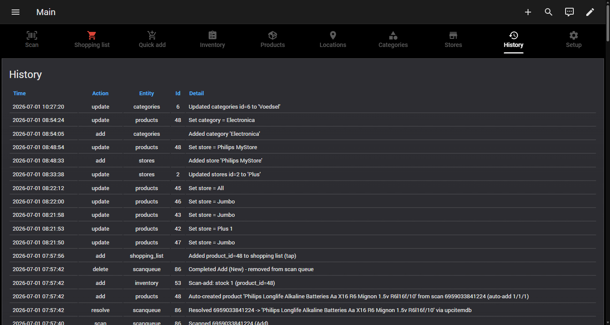

The tab shows the **latest 50 entries**. Behind the scenes, history rows older than
**3 months** are purged automatically, so the log stays a useful recent trail without
growing without bound.

---

## 9. Settings & language (Setup tab)

The **Setup** tab holds application settings: the **Language** selector, a **Show ID
columns** toggle, a **Hide header (kiosk)** toggle, a **Handheld scanner** section, a
**Similarity checking** section, an **Alternative in stock** section, and the **Spoken
announcements (TTS)** and **Mobile notifications** sections.

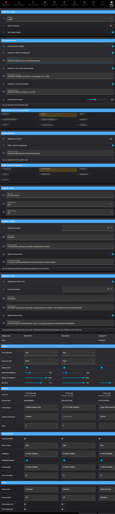

### Show ID columns

Off by default. Turn it on to reveal the database **ID** column on every table (useful for
troubleshooting or cross-referencing); toggling it updates all tables instantly.

### Hide header (kiosk)

Turns kiosk mode on/off for the VH-Inventory dashboard. When on, the Home Assistant top bar
(header) is hidden for a clean, full-screen touchscreen view; when off, the header returns.
The change applies live via the kiosk-mode plugin — the first time after install you may need
a single hard refresh (Ctrl+F5).

### Switching language

Pick **English** or **Nederlands** from **Setup > Language**. Both dashboards use
the same `input_select.vh_language`. You can also open the touchscreen's hamburger
menu, choose **Configuratie**, edit **Application settings > Language** and
press **Save / Opslaan**. Cancelling that editor does not change the language.

Tabs, navigation, table titles, column headers, pop-up titles, buttons and field
labels follow the shared selection. The touchscreen retains open edits, keyboard
focus, inline typing, filters, scanner mode and the last scan. Product, location,
category and device names, barcodes and entered values stay unchanged.
Reload both browser pages once after installing the shared-language update.

Here is the **Products** tab with the language set to **Nederlands**:

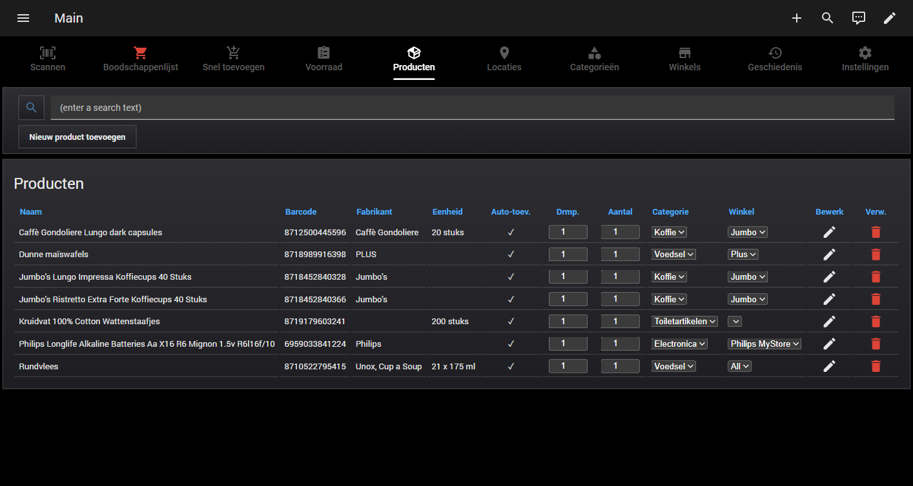

Notice that the chrome is translated (*Producten, Naam, Fabrikant, Eenheid, Categorie,
Winkel, Bewerk, Verw., Toevoegen*) while the product data stays exactly as entered.

> **Adding more languages:** drop a new `translations/<code>.json` file, add its display
> name to the language selector, and update both dashboards' embedded maps. Keep
> shared wording in `generic`, main-only wording in `main`, and touchscreen-only
> wording in `touchscreen`. See the Installation Guide, section 10.

### Spoken announcements (TTS)

Optional Dutch voice announcements play through your Sonos speakers via the
[Chime TTS](https://github.com/nimroddolev/chime_tts) integration. They run **independently
of the core inventory logic**, so a slow or offline speaker never blocks or delays scanning.

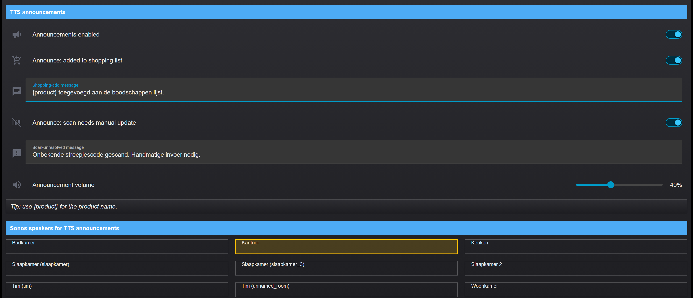

- **Enable announcements** — master on/off switch for all spoken announcements.
- **Sonos speakers for TTS announcements** — pick which speakers play the announcements
  (multi-select chips; tap to toggle).
- **Volume** — slider that sets the announcement volume. Any media already playing on a
  target speaker is briefly interrupted for the announcement and then resumes.
- **Per-announcement switches** — turn each announcement on/off individually:
  - *Product added to shopping list* — says "&lt;product&gt; toegevoegd aan de
    boodschappenlijst."
  - *Used from inventory* — when a product is consumed (via **any** scanner) and stock
    remains, says "&lt;product&gt; verbruikt, nog &lt;qty&gt; op voorraad."
  - *Unresolved scan* — announced when a scanned barcode can't be resolved and needs
    manual entry.
- **Editable message text** — each announcement's wording is editable in its own input
  field. Use the `{product}` placeholder to insert the product name, and `{qty}` (in the
  *Used from inventory* message) to insert the remaining stock.

### Mobile notifications

Optional push notifications to the Home Assistant companion app, configured just like TTS
and equally decoupled from the core logic:

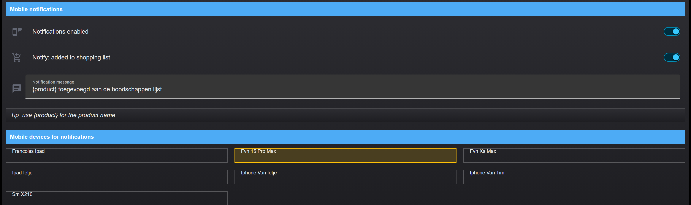

- **Enable notifications** — master on/off switch.
- **Mobile devices for notifications** — pick which devices receive the push. The list is
  built automatically from the `mobile_app_*` notify services registered in your Home
  Assistant.
- **Per-notification switch & editable text** — the *product added to shopping list*
  notification, with its own on/off switch and editable message text.

Spoken announcements and mobile notifications listen to the same internal event, so if both
are enabled a product added to the shopping list triggers a spoken announcement **and** a
push notification.

### Handheld scanner

Configuration for the physical [handheld (MQTT) scanner](#handheld-mqtt-scanner):

- **MQTT topic** — the topic your ESPHome scanner publishes barcodes to (default
  `barcode/scanned`). Editing it re-subscribes the backend automatically; no restart needed.
- **Color Add mode / Color Use mode** — the colours of the Inventory-tab mode toggle for
  each mode (defaults cyan for Add, red for Use). Pick from the shared colour palette.

Handheld scan outcomes are announced through the shared, scanner-agnostic *Spoken
announcements (TTS)* and *Mobile notifications* sections above — there are no longer any
handheld-specific notification messages.

### Smart (AI) matching

Both the *Similarity checking* and *Alternative in stock* checks below decide whether two
product names refer to the **same product**. By default this is a word/character comparison,
which can't tell that *Coca Cola Lime* and *Coca Cola Zero* are different products (different
flavour) while *Campina magere melk* and *Houdbare magere melk* are the same product (only the
brand and shelf-life differ). Turning on **Smart (AI) matching** hands that judgement to a Home
Assistant **conversation agent** (Google Generative AI / Gemini by default), which understands
what the words *mean*.

- **Use AI matching** — master on/off. When **on**, the two checks ask the AI whether a scanned
  product is the same as one already listed. When **off** — or if the agent errors, times out or
  is offline — the built-in word-based scorer is used as a fallback, so the feature never fully
  breaks. This only changes *how* a match is decided; the checks still run at the same moments
  (Add scan for similarity, last-unit Use scan for alternative-in-stock).
- **Conversation agent** — the agent entity to ask. Default `conversation.google_generative_ai`.
- **Matching policy** — plain-language rules telling the AI which differences make two products
  the **same** (brand, shop, shelf-life, packaging) versus **different** (flavour, variety, type).
  Edit this to tune the behaviour without touching code.

Every AI (and fallback) decision is written to **History** with the method used, the AI's
**confidence** (0–100 %) and the **time** the answer took, e.g.
`… -> popup [AI, conf 95%, 1420 ms]`.

> **Note:** with AI matching on, the scanned product name and the current shopping/stock list
> names are sent to the conversation agent's provider (e.g. Google) for the judgement, and each
> scan makes one request. Turn it off to keep matching fully local.

#### Health & daily usage

Conversation agents have a **request quota**. Gemini's free tier, for example, limits
requests-per-minute and requests-per-day (RPD), and the daily allowance resets at **midnight
Pacific**. When the agent refuses a call (an error, a timeout or an HTTP 429 "quota exceeded"),
matching silently falls back to the word-based scorer — which means the false matches you enabled
AI matching to avoid can briefly return. This section makes that visible and can alert you:

- **Matching degraded** — turns **on** when a call fails and the word-based scorer is being used,
  and clears automatically on the next successful AI call. Watch this on the Setup tab as an
  always-visible health indicator.
- **AI matches today** / **Failures today** — counters of how many matching requests were made and
  how many failed. They **reset daily at midnight Pacific** to stay in sync with the real quota.
- **Daily request limit** — set this to your model's requests-per-day to see how close you are and
  get a one-off warning at 80 % and at 100 % of it. Leave it at **0** if you don't know the limit
  (no usage warning is then shown).
- **Notify when degraded** — when on, sends a **mobile push** (to the devices selected under
  *Notifications*) the first time matching becomes degraded or reaches the daily limit. These
  pushes are throttled to at most once per hour and also require the master *Notifications* toggle
  to be on. The message text is editable in **Degraded message**.

### Similarity checking

When a product is scanned in **Add** mode, its resolved name is compared against the products
already on the shopping list. If a close match is found, an informative pop-up is raised on
the large-screen scanner that did the scan (`barcode-01` or `barcode-02`) asking whether the
scanned item is the same product bought in a different shop. This helps avoid creating
duplicate entries for the same product under slightly different names (e.g. *Campina magere
melk* vs *Houdbare magere melk*).

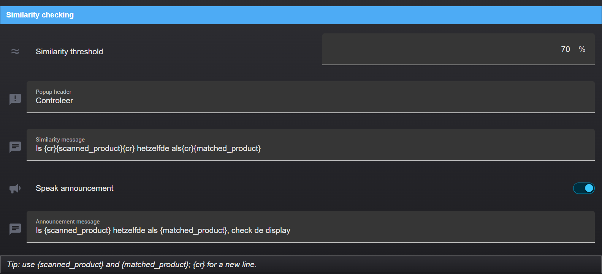

- **Similarity threshold** — the minimum match score (0–100 %) required to raise the pop-up.
  Lower it to catch looser matches, raise it to only flag near-identical names. Default `70`.
  The scorer is a hybrid of character-level and shared-word (token-set) similarity, so
  products that share their core words score high even when the brand/prefix differs.
- **Popup header** — the title shown on the pop-up. Default *Similar product found*.
- **Similarity message** — the pop-up body text. Use the `{scanned_product}` placeholder for
  the just-scanned product name and `{matched_product}` for the matching shopping-list item;
  both are shown in a contrasting **gold** colour against the dimmed-white message text.
  Insert `{cr}` anywhere to force a line break. Default *Is {scanned_product} similar to
  {matched_product}*.

The pop-up's **Yes** button confirms the scanned product is the same as the matched
shopping-list product and **removes that matched product from the shopping list**;
**No** simply dismisses the pop-up. Both buttons also close the pop-up and reset
themselves. (Works on both large-screen scanners, `barcode-01` and `barcode-02`; the popup
appears on whichever one did the scan.)

Ad-Hoc products are checked first. An exact normalized name match is deterministic; other
Ad-Hoc names use the same configured AI/string similarity engine and threshold. The
Ad-Hoc-specific header and message are independently configurable. Its message supports
`{scanned_product}`, `{adhoc_product}`, `{adhoc_quantity}`, and `{cr}`. The prompt clearly
states that **Yes removes the complete Ad-Hoc row**, including a quantity greater than one.
Popup context is stored separately per large-screen scanner, so simultaneous prompts cannot
remove each other's shopping-list row.

- **Speak announcement** — optional on/off toggle. When on, a spoken TTS prompt is played
  **together with** the pop-up (but fully decoupled, so it never delays scanning) through the
  same Sonos speakers and volume as the other announcements. It also requires the master
  *Announcements enabled* switch (in *Spoken announcements (TTS)*) to be on.
- **Announcement message** — the spoken text. Uses the same `{scanned_product}` /
  `{matched_product}` placeholders. Default *Is {scanned_product} hetzelfde als
  {matched_product}, check de display*.

All Setup-tab settings are backed by input helpers and **persist across Home Assistant
restarts**.

### Alternative in stock

When a product is scanned in **Use** mode and this consumes its **last unit** (stock reaches
0), the backend normally re-adds it to the shopping list. But you may already have an
equivalent product on the shelf that was simply bought under a different barcode/brand. To
avoid buying more than you need, the *Alternative in stock* check compares the just-emptied
product's name against everything **still in stock**. If a close enough match is found, the
product is **not** added automatically. Instead an **interactive Info Popup** is raised on
the large-screen scanner that did the scan (`barcode-01` or `barcode-02`) asking whether to
add it to the shopping list anyway, and a spoken announcement offers the in-stock
alternative. The stock decrement always happens as normal.

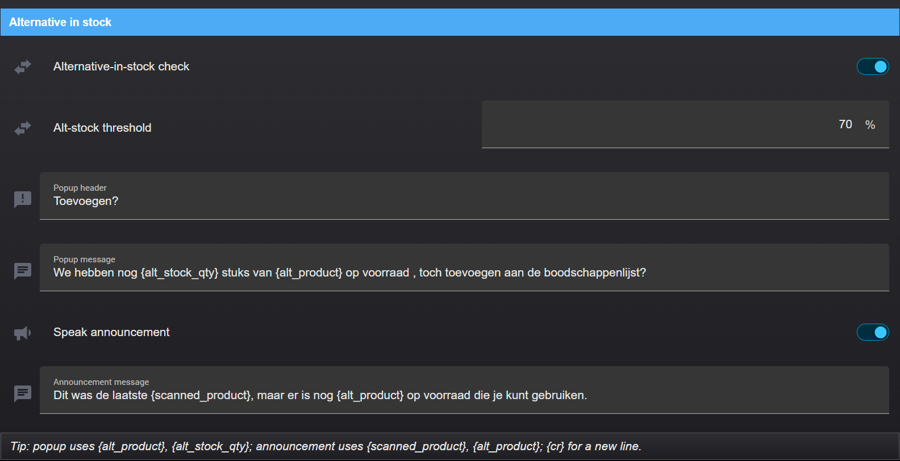

The popup has two buttons:

- **No** (Nee) — keep the product **off** the shopping list (the default). The popup closes
  and the decision is logged to History (`alt-keep`).
- **Yes** (Ja) — add the just-emptied product to the shopping list after all. The popup closes
  and the add is logged to History (`alt-add`).

> The popup reuses each scanner's shared Yes/No buttons. The backend remembers which popup is
> showing (Add-mode *similar product* vs Use-mode *alternative in stock*) so each button does
> the right thing.

- **Alternative-in-stock check** — master on/off for this behaviour. Default **on**.
- **Alt-stock threshold** — the minimum match score (0–100 %) required to treat an in-stock
  product as an equivalent. Default `90` — deliberately higher than the Add-mode similarity
  threshold, because a false match here would keep a genuinely-needed product off your
  shopping list unless you tap Yes. Uses the same hybrid name scorer.
- **Popup header** — the temporary title shown on the popup. Default *Toevoegen?*
- **Popup message** — the popup body text. Use `{alt_product}` for the in-stock alternative
  and `{alt_stock_qty}` for how many of it are in stock; `{cr}` forces a new line. These
  variables are highlighted in gold. Default *Van {alt_product} is de voorraad
  {alt_stock_qty}, toch toevoegen aan de boodschappenlijst?*
- **Speak announcement** — optional on/off toggle for the spoken prompt, played fully
  decoupled from the scan. Also requires the master *Announcements enabled* switch.
- **Announcement message** — the spoken text. Use `{scanned_product}` for the emptied product
  and `{alt_product}` for the in-stock alternative. Default *Dit was het laatste item
  {scanned_product}, maar er is nog {alt_product} op voorraad die je kunt gebruiken.*

Every step is recorded in the History log (`alt-in-stock` when the popup is raised, `alt-add`
on Yes, `alt-keep` on No) so the behaviour is fully auditable. This is name-similarity based
(phase 1); explicit product-alternative links may be added later for cross-brand alternatives
that do not share words (e.g. different product names entirely).

---

## 10. Tips & behaviours

- **Autofocus:** selecting the Scan tab focuses the Barcode field automatically — no extra
  click needed before scanning.
- **Handheld scanner:** a physical MQTT scanner adds or consumes stock hands-free; toggle
  **Add / Use** mode from the Inventory tab and set its topic/colours on the Setup tab.
- **Search by name or barcode:** table search boxes match on either the product name or the
  barcode (any partial match).
- **Quick tabs:** *Quick Shopping* adds/removes products on the shopping list; *Quick Inventory*
  removes-from or adds-to stock. Buttons share the dark glass style of the touchscreen dashboards.
- **Printing:** the shopping list prints grouped per store; the inventory prints grouped per
  category (filtered to the selected category, or all). Both use the ESC/POS thermal printer.
  Network printers must have **Keep Alive** enabled in the integration options to keep the
  styled header, body and footer together as one ordered receipt.
- **Pop-ups close on Save:** Add/Edit dialogs close themselves after a successful save.
- **Cascade delete:** deleting a product cleans up its inventory and shopping-list rows.
- **Shopping list:** pressing **–** at quantity 1 removes the item from the list.
- **History retention:** the tab shows the latest 50 entries; rows older than 3 months are
  purged automatically.
- **Kiosk mode:** the *Hide header (kiosk)* toggle on the Setup tab shows/hides the HA top bar.
- **Footer navigation:** two right-aligned footer buttons jump to the **Woonkamer** and
  **Kantoor** touchscreen dashboards.
- **Decoupled notifications:** spoken (TTS) announcements and mobile push notifications run
  independently of the core inventory logic, so they never block or slow down scanning.
- **Duplicate-name guard:** locations, categories and stores must be unique.
- **Self-healing data model:** the database and any new columns are created automatically;
  you never run SQL by hand.

---

## 11. Data model (reference)

Workstreams: general

This reference describes the repository's current schema for administrators and
contributors. It contains definitions only, not household data. The source of
truth is `DB_SCHEMA` and `_ensure_schema()` in
[`pyscript/apps/vh_inventory/__init__.py`](../pyscript/apps/vh_inventory/__init__.py).
Existing migrated databases can retain older constraints; this is not a live
database inspection.

### Database diagram

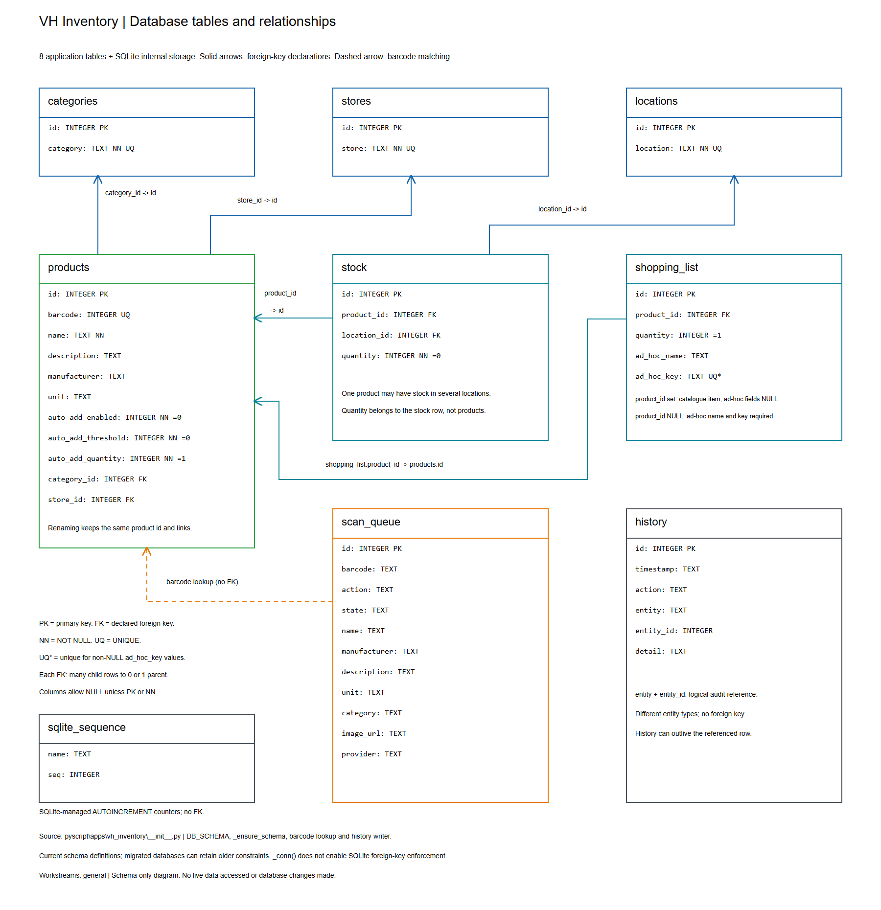

[Zoomable SVG](diagrams/database-schema.svg) |
[Editable Excalidraw source](diagrams/database-schema.excalidraw)

### Table overview

| Table | Purpose | Published sensor |
|---|---|---|
| `categories` | Product category reference list. | `sensor.vh_inventory_categories` |
| `stores` | Product store reference list. | `sensor.vh_inventory_stores` |
| `locations` | Stock storage-location reference list. | `sensor.vh_inventory_locations` |
| `products` | Shared catalogue, barcode and automatic-shopping settings. | `sensor.vh_inventory_products` |
| `stock` | Quantity of one product at one location. | `sensor.vh_inventory_stock` |
| `shopping_list` | Catalogue-linked items or standalone ad-hoc items to buy. | `sensor.vh_inventory_shopping` |
| `scan_queue` | Barcode scans and lookup/resolve metadata. | `sensor.vh_inventory_scan_queue` |
| `history` | Audit events, including references to rows that may later be deleted. | `sensor.vh_inventory_history` |
| `sqlite_sequence` | SQLite internal AUTOINCREMENT counters, not an application table. | Not published. |

The eight application tables contain 44 columns. All application `id` columns
are `INTEGER PRIMARY KEY AUTOINCREMENT`. Other columns allow NULL unless marked
`NOT NULL` below or conditionally required by the shopping-list triggers.

### categories

| Column | Type | Constraints |
|---|---|---|
| `id` | INTEGER | Primary key, AUTOINCREMENT. |
| `category` | TEXT | NOT NULL, UNIQUE. |

### stores

| Column | Type | Constraints |
|---|---|---|
| `id` | INTEGER | Primary key, AUTOINCREMENT. |
| `store` | TEXT | NOT NULL, UNIQUE. |

### locations

| Column | Type | Constraints |
|---|---|---|
| `id` | INTEGER | Primary key, AUTOINCREMENT. |
| `location` | TEXT | NOT NULL, UNIQUE. |

### products

| Column | Type | Constraints or meaning |
|---|---|---|
| `id` | INTEGER | Primary key, AUTOINCREMENT. Retained when renaming. |
| `barcode` | INTEGER | UNIQUE; may be NULL. |
| `name` | TEXT | NOT NULL. Not database-unique; the touchscreen editor rejects duplicate names. |
| `description` | TEXT | Optional product description. |
| `manufacturer` | TEXT | Optional manufacturer. |
| `unit` | TEXT | Optional unit. |
| `auto_add_enabled` | INTEGER | NOT NULL, default 0. |
| `auto_add_threshold` | INTEGER | NOT NULL, default 0. |
| `auto_add_quantity` | INTEGER | NOT NULL, default 1. |
| `category_id` | INTEGER | Nullable reference to `categories.id`. |
| `store_id` | INTEGER | Nullable reference to `stores.id`. |
| `almost_out` | INTEGER | NOT NULL, default 0, CHECK 0 or 1. One pending consumption per product, managed by Keuken Touchscreen only. |

`almost_out=1` means the current package was already deducted while nearly empty.
The next touchscreen `Use` action (**Verbruikt** on Scannen) clears it without another deduction.
**Toevoegen** retains it while adding stock normally. The flag is not a physical
package count and is shared across the product's stock locations. Main-dashboard
and ESPHome operations retain their existing behavior and do not honor this flag.
See [Almost out](TOUCHSCREEN.md#almost-out--bijna-op) for the complete workflow.

### stock

| Column | Type | Constraints or meaning |
|---|---|---|
| `id` | INTEGER | Primary key, AUTOINCREMENT. Identifies the selected inventory row. |
| `product_id` | INTEGER | Nullable reference to `products.id` in the schema. Normal stock operations link an existing product. |
| `location_id` | INTEGER | Nullable reference to `locations.id`; NULL means unassigned. |
| `quantity` | INTEGER | NOT NULL, default 0. Normal inventory views show positive stock only. |

A product can have stock at multiple locations. The schema does not declare a
UNIQUE constraint on `(product_id, location_id)`; stock services handle matching
and merging. The touchscreen full editor rejects an occupied destination instead
of merging silently. Its inline location dropdown retains the merge behavior.

### shopping_list

| Column | Type | Constraints or meaning |
|---|---|---|
| `id` | INTEGER | Primary key, AUTOINCREMENT. Identifies the shopping row, not its product. |
| `product_id` | INTEGER | Nullable reference to `products.id`. NULL for an ad-hoc item. |
| `quantity` | INTEGER | Default 1. |
| `ad_hoc_name` | TEXT | Display name for an ad-hoc item. |
| `ad_hoc_key` | TEXT | Application-normalized ad-hoc key; unique when non-NULL. |

The insert/update validation triggers require exactly one item representation:
either `product_id` is set and both ad-hoc fields are NULL, or `product_id` is
NULL and both ad-hoc fields contain nonblank values. The partial unique index
`idx_shopping_adhoc_key` covers `ad_hoc_key WHERE ad_hoc_key IS NOT NULL`.

### scan_queue

| Column | Type | Constraints or meaning |
|---|---|---|
| `id` | INTEGER | Primary key, AUTOINCREMENT. |
| `barcode` | TEXT | Matched to catalogue barcodes by application logic, not a foreign key. |
| `action` | TEXT | CHECK: `Add` or `Use`. |
| `state` | TEXT | CHECK: `New`, `Lookup`, `Unknown`, `Manual` or `Exist`. |
| `name` | TEXT | Lookup result or manually supplied name. |
| `manufacturer` | TEXT | Lookup metadata. |
| `description` | TEXT | Lookup metadata. |
| `unit` | TEXT | Lookup metadata. |
| `category` | TEXT | Lookup category text, not `categories.id`. |
| `image_url` | TEXT | Lookup image URL. |
| `provider` | TEXT | Lookup provider. |

The queue has no `product_id` column and no declared foreign keys.

### history

| Column | Type | Constraints or meaning |
|---|---|---|
| `id` | INTEGER | Primary key, AUTOINCREMENT. |
| `timestamp` | TEXT | Event timestamp. |
| `action` | TEXT | Recorded action. |
| `entity` | TEXT | Entity type associated with the event. |
| `entity_id` | INTEGER | Logical entity reference; not a foreign key. |
| `detail` | TEXT | Event details. |

`entity` and `entity_id` describe different entity types. History can remain after
the referenced row is deleted, so there is no single-table SQL foreign key.

### SQLite internal storage

`sqlite_sequence` contains `name` and `seq`, maintained by SQLite for
AUTOINCREMENT tables. It has no declared foreign keys. Do not edit it as
inventory data.

### Relationships and update boundaries

| Child column | Parent column | Relationship |
|---|---|---|
| `products.category_id` | `categories.id` | Many products to zero or one category. |
| `products.store_id` | `stores.id` | Many products to zero or one store. |
| `stock.product_id` | `products.id` | Many stock rows to zero or one product in the declared schema. |
| `stock.location_id` | `locations.id` | Many stock rows to zero or one location. |
| `shopping_list.product_id` | `products.id` | Many shopping rows to zero or one product; ad-hoc rows have no product link. |

These are five declared `REFERENCES` relationships. `_conn()` currently does not
enable SQLite `PRAGMA foreign_keys`; do not assume the declarations provide
runtime enforcement or cascading cleanup. Application services validate and
maintain their supported links. Adding or changing enforcement is a separate
behavioral/database change, not part of the touchscreen addition.

The ID-based touchscreen editor updates product metadata in `products` and
location/quantity in the selected `stock` row. It does not replace the product,
write `stock.product_id`, create tables or alter the schema. Product, selected
stock and history writes share one transaction. Shopping reconciliation and
sensor publication follow the commit and are not part of that transaction.

Use the supported services rather than editing a live SQLite file over a
network share. See [backup and restore](INSTALLATION.md#12-backup--restore)
before any data repair or migration.
